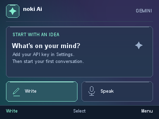
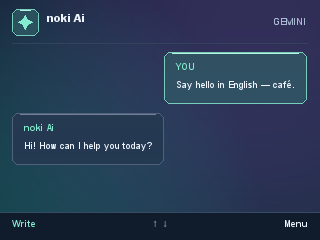

# noki Ai

A lightweight AI client for older Nokia phones that support Java ME apps.
Powered by Google Gemini, with text chat, short voice messages and a dark interface.
Connects directly to Google — no PC bridge needed.

## Devices

Designed for **Nokia E63 (320 × 240)**. Other phones with **MIDP 2.0 / CLDC 1.1**
may work, but have not been tested. Camera, file and voice features depend on the device.

A working HTTPS connection is required. Older Symbian firmware may need a
[TLS update](https://nnproject.cc/tls/).

## Getting started

1. Install `NokiAi.jar` on your phone.
2. Get an API key from [Google AI Studio](https://aistudio.google.com/apikey).
3. Open **Menu → Settings**, enter your **Google API key** and press **Save**.
4. Choose **Write**, type your question and press **Send**.

For QR setup, open `key-qr.html` on another device. Generate a QR from your key,
then use **Settings → Menu → Scan QR** on the phone and press **Save**.
Use **Chat models** in the same menu to select an available model.

## Controls and voice

- Right softkey: **Menu**. Center key: select or edit. Left softkey: the displayed action.
- Up/down: scroll chat. Left/right: scroll a page. `#` also opens the menu.
- **Speak**: record up to 15 seconds, then **Stop → Send**.
- **Read aloud**: speaks the start of a reply using a separate TTS request.
  Choose a supported model under **Settings → Menu → Voice models**.

Audio is uploaded only after Send. Voice features still need real-device testing.
Replies follow your question's language. Google API quotas and pricing apply.

## Screenshots

Emulator screenshots with a sample conversation.




## Build

On Windows, install a JDK (tested with JDK 21), set `JAVA_HOME` and run:

```powershell
.\build.ps1
```

Files are created in `dist/`. See [CONTRIBUTING.md](CONTRIBUTING.md) for testing.

## Privacy and license

Chats stay in memory. **Remember key** stores your key on the phone without extra
encryption. Never share your key or QR image.

[MIT License](LICENSE) · [Third-party notices](THIRD_PARTY.md)
